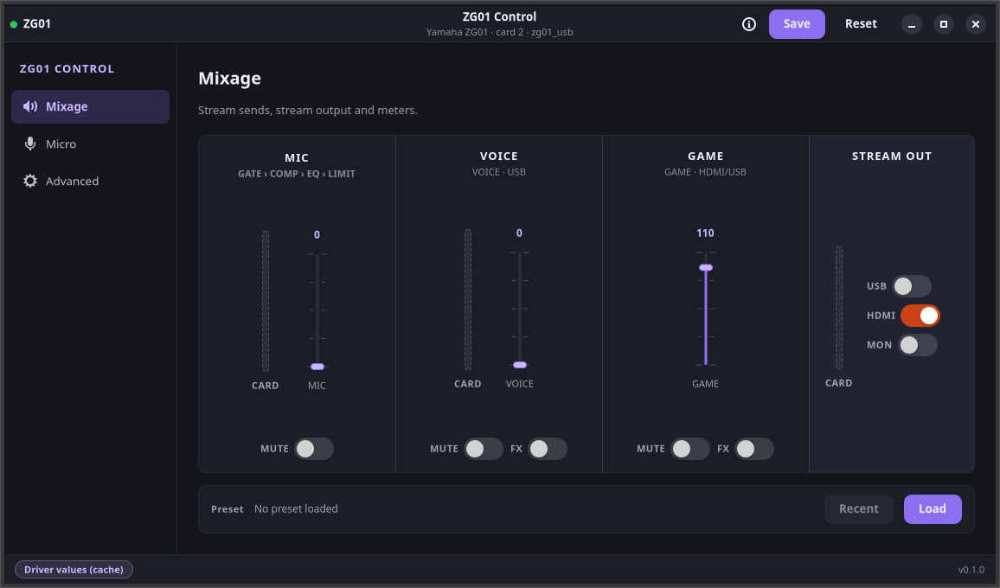

# Yamaha ZG01 Linux kernel driver

An ALSA driver for the Yamaha ZG01 USB audio interface (VID 0x0499, PID
0x1513). The device uses a vendor-specific protocol, so this driver reverse
engineers it from USB captures instead of using the generic `snd-usb-audio`
class driver.

## How the driver maps the device

The ZG01 carries both playback channels on one isochronous endpoint. The
driver mixes them into the shared URB stream. It exposes one ALSA card with
three PCM devices:

| PCM device | Name | Direction | Rates | Packet |
|---|---|---|---|---|
| 0 | Game Out | playback | 48 kHz | 240 B: 6 frames x 40 B |
| 1 | Voice Out | playback | 48 kHz | shared EP 0x01 with Game Out |
| 2 | Voice In | capture | 48 kHz | 108 B nominal: 8 B header, 5-7 frames x 16 B, 4 B trailer |

All channels run S32_LE stereo. Both sinks work at the same time. Both
packages install a UCM profile, so PipeWire shows the devices as separate
sinks named Game Out, Voice Out, and Voice In. Without it, userspace falls
back to the single generic stereo profile and only Game Out is exposed.

A single out chain serves both playback PCMs. When only Voice Out runs, the
chain sends keepalive silence on the shared endpoint. When both run, the URB
callback mixes both PCM streams into each packet. This preserves the two
sinks without moving the mix into userspace.

## Install

### Arch Linux, CachyOS, Omarchy

Prebuilt packages (`snd-zg01-dkms-git-*.pkg.tar.zst` and
`zgctl-git-*.pkg.tar.zst`) are attached to each driver/tools
[GitHub release](https://github.com/bsauvajon/snd-zg01/releases/latest);
install the downloaded files with `sudo pacman -U <file>`. The driver,
`zgctl` and GUI packages are attached to the same `vX.Y.Z` releases
(v2.1.0 and later). A `gui-vX.Y.Z` tag remains available for a GUI-only
build.

To build it yourself instead, install the build tools, DKMS, and the headers
for the running kernel:

```bash
sudo pacman -S --needed base-devel dkms linux-headers git alsa-ucm-conf
```

Other kernel variants need their matching headers instead (for example
`linux-lts-headers` or `linux-zen-headers`). Then build and install:

```bash
cd packaging/arch
makepkg --cleanbuild
sudo pacman -U snd-zg01-dkms-git-*.pkg.tar.zst
```

DKMS hooks build the module for every installed kernel with matching
headers; without them DKMS registers nothing, so the package warns at install
time when the running kernel has no headers. The package installs the
modules-load.d entry and the UCM profile. Reboot after install so `snd-zg01`
registers before the generic Yamaha match claims the device. See
`packaging/arch/README.md` for verification and rollback.

### Debian, Ubuntu

Add the signed APT repository, then install:

```bash
sudo install -d -m 0755 /etc/apt/keyrings
curl -fsSL https://raw.githubusercontent.com/bsauvajon/snd-zg01/main/apt/snd-zg01.asc \
  | sudo tee /etc/apt/keyrings/snd-zg01.asc >/dev/null
curl -fsSL https://raw.githubusercontent.com/bsauvajon/snd-zg01/main/apt/snd-zg01.sources \
  | sudo tee /etc/apt/sources.list.d/snd-zg01.sources >/dev/null
sudo apt update
sudo apt install snd-zg01-dkms snd-zg01-tools
```

`snd-zg01-tools` is optional and ships `zgctl`; `snd-zg01-gui` is the
optional GTK4 GUI. Install only `snd-zg01-dkms` for the driver alone. The
APT repository is refreshed by `v*` releases, which also attach the GUI
`.deb` and the Arch GUI package. A `gui-vX.Y.Z` tag remains available for a
GUI-only build.

Or download the `.deb` files from the release that matches the version you
want:

```bash
sudo dpkg -i snd-zg01-dkms_*.deb snd-zg01-tools_*_amd64.deb \
  snd-zg01-gui_*_amd64.deb
sudo apt-get install -f   # only if dependencies are missing
```

### From source

The module builds against kernel headers. Clang-built kernels need the LLVM
front end; the Makefile reads `CONFIG_CC_IS_CLANG` from the target kernel and
sets it. A user-supplied `LLVM=` value wins over the auto-detection:

```bash
make
sudo modprobe snd-zg01
```

## Verify

With the device connected:

```bash
cat /proc/asound/cards      # one card: zg01
lsmod | grep snd_zg01
journalctl -b -k --grep zg01
```

The card offers three PCM devices: `hw:N,0` Game Out, `hw:N,1` Voice Out,
`hw:N,2` Voice In. With the UCM profile installed, PipeWire names them the
same way.

```bash
# Game Out
speaker-test -D hw:zg01,0 -c 2 -r 48000 -F S32_LE -t sine -f 440 -l 1
# Voice In
arecord -D hw:zg01,2 -f S32_LE -r 48000 -c 2 -d 5 test.wav
```

Voice In logs bursts of `-ECONNRESET` on the first open. They are benign;
the chain resubmits.

## Mixer controls

The card exposes 367 writable mixer controls: the 208 original controls
plus 159 generated from the 375-address control map.  The eight read-only
status addresses (`docs/FEATURE_PARITY.md`) have no ALSA control.  The
microphone DSP block came first: GATE, COMP and LIMITER switches and
levels, the EQ switch, four EQ band gains, frequencies and Q, and the
low/high shelf types.  The microphone effect chain (voice changer,
radio/tremolo, voice reverb, tone control, sound effect, echo) and the
game effect chain (three effect slots, the game FX switch and type, the
de-esser, the M and S four-band EQs and the ten-band game EQ) follow it,
then the monitor/headphone, binaural, streaming, preset-name and remaining
controls.  They are written to the device through the interface 4 bulk
protocol (`docs/MIC_CONTROL_PROTOCOL.md`); the two effect blocks have
their own record in `docs/EFFECTS_CONTROL_PLAN.md`.

```bash
make -C tools
./tools/zgctl list
./tools/zgctl set 'EQ Band 1 Gain' +6.0
./tools/zgctl set 'EQ Band 2 Frequency' 1k
./tools/zgctl set 'Limiter' 42
./tools/zgctl set 'Voice Reverb Wet' 40
./tools/zgctl set 'Game EQ Band 1 Gain' +3.0
./tools/zgctl save          # persist the current settings to the device
./tools/zgctl reset         # reload the persisted settings
```

`zgctl` accepts dB for gains, Hz/kHz for frequencies, ratios for Q and
on/off for switches; the same controls are reachable with `amixer
cget/cset`.  Gains cover -18.0..+18.0 dB in 0.1 dB steps, Q spans
0.5..16 (12 steps per octave) and every band frequency is taken in plain
Hz inside its own range; the controls start from the vendor defaults
(100 Hz / 500 Hz / 2.5 kHz / 10 kHz, Q 1, gains 0 dB, gate and compressor
levels 50).  The effect controls keep the same units where the vendor
model establishes them (the 0..360 gains in 0.1 dB, the 0..60 bandwidths
in 0.01 Q, the ten-band game EQ in Hz) and publish device steps
otherwise; the tone-control and game EQ M/S band frequencies are indices
on a 1/12-octave grid, which `docs/EFFECTS_CONTROL_PLAN.md` documents.
`zgctl save` (the `Save to ZG01` control) persists the
current settings to the device's non-volatile memory; `zgctl reset`
(the `Reset to ZG01` control) reloads the persisted settings.

Writes reach the device live.  Reading values back is not implemented:
the getters return the **last value the driver wrote** (a cache seeded
with the built-in defaults at load).  Settings changed outside the driver
(ZG Controller on Windows, or `reset`) are therefore not reflected until
the control is written again from Linux.  This is the documented
behaviour; see `docs/MIC_CONTROL_PROTOCOL.md`.

### Meters

The card reports six meter groups as read-only ALSA integer controls. The
two mic groups carry one value; the four surround groups carry eight
values, one per channel:

- `Meter Mic In` (1 value): the mic before the gate.
- `Meter Mic Out` (1 value): the mic after the gate.
- `Meter PC In` (8 values): the USB PC playback; Game Out is on L/R in
  the measured captures.
- `Meter HDMI In` (8 values): the HDMI input, on L/R in the measured
  captures.
- `Meter Game Mix` (8 values): the game mix; HDMI and Game Out are on L/R
  in the measured captures.
- `Meter Stream Mix` (8 values): the streaming output mix; Voice playback
  is on L/R in the measured captures. The exact VOICE strip mapping is
  still open.

Each value is 0–127 and linear in dB: 0 is −127 dB and 127 is 0 dBFS.
The device sends a frame about every 50 ms (20 Hz); a read returns the
latest valid frame. The controls are read-only and volatile, so
`amixer` shows `r--v` and refuses writes. Until a valid frame arrives,
or after the reader stops, a read returns an error rather than zero.

```bash
amixer -c zg01 cget 'name=Meter PC In'   # values=8
amixer -c zg01 cget 'name=Meter Mic In'  # values=1
```

The GUI polls the six controls at 20 Hz on a worker thread. The Mixage
strips use `mic_in`, `pc_in` L/R, `game_mix` L/R and `stream_mix` L/R; the
new **Meters** page shows every channel of the four surround groups plus
the two mic levels. It also draws a thin `PW` bar beside the card bar from
the Linux PipeWire graph: `Voice In` for MIC, `Voice Out` for VOICE and
`Game Out` for GAME. The two bars share the card dB scale, so a given
height means the same level. STREAM OUT has no Linux source and stays
card-only. When PipeWire or a node is unavailable, the `PW` bar is hidden;
a source with no frames is drawn dashed, never as zero.

An older driver with only the four one-value controls is detected and kept
in the legacy four-meter view; the Meters page is disabled and the legacy
values are not remapped. See `docs/METER_PROTOCOL.md` and the acceptance
record in `docs/METER_TEST.md`.

## GUI (ZG01 Control)

The repository also ships `zg01-control`, a GTK4/libadwaita control GUI. It
is a separate package: installing it never pulls the DKMS build
dependencies, and installing the driver or `zgctl` never pulls GTK. The
source lives in `gui/`; the binary needs the driver to expose the controls.

### Install and launch

Arch Linux:

```bash
cd packaging/arch/zg01-control-git
makepkg --cleanbuild
sudo pacman -U zg01-control-git-*.pkg.tar.zst
```

Debian/Ubuntu (after adding the APT repository described above):

```bash
sudo apt install snd-zg01-gui
```

From source:

```bash
make -C gui build
sudo make -C gui install          # PREFIX=/usr/local by default
```

Launch it from the application menu or with `zg01-control`. The application
ID is `io.github.bsauvajon.Zg01Control`. The GUI runs as the logged-in user
and needs no root; it opens the ALSA control device directly.

### Screens

- **Mixage** is the landing screen: three stream sends (MIC, VOICE, GAME),
  the STREAM OUT switches and meter, the card meters and the preset bar.
- **Micro** is the microphone chain: GATE, COMP, LIMIT, the four-band EQ and
  the per-block advanced expander.
- **Avancé** lists every ALSA control the curated screens do not claim, with
  a search field, a section filter and a type-aware editor.

### Current feature set

- Mixage: three stream sends, STREAM OUT routing switches, card and
  PipeWire VU meters, and the preset bar.
- Micro: gate, compressor, limiter and four-band EQ controls, plus
  **Read from ZG01** for the direct MIC state dump.
- Avancé: every remaining ALSA control, with search, section filtering and
  type-aware editors.
- Save/Reset, `.zgpreset` loading with a preview (per-block filtering is
  available in `zgctl`), disconnect/reconnect recovery, keyboard-accessible
  faders, French translation and desktop/packaging integration.

**Sauvegarder** persists the current values with `Save to ZG01`.
**Réinitialiser** reloads the persisted settings and starts a fresh MIC
state read. Direct MIC fields (gate switch/value/range, compressor and
limiter switches/levels, EQ switch/shapes/Q) are refreshed from the device;
the transformed MIC fields and the non-MIC sections become unknown until a
control is written or a preset is applied. The Micro screen also offers
**Read from ZG01** for a fresh read without a reset. Presets are loaded from
`.zgpreset` files through the same parser as `zgctl`; `.zg01` backups are
rejected.

### Mixage is a stream mixer, not a local monitor

The MIC, VOICE and GAME faders are the **stream sends**
(`Streaming Mic/Voice/Game Level Steps`). They set how much of each source
goes to the ZG01's USB/stream mix, not the level in the local headphones or
speakers. The local monitor is controlled by the physical knobs and the
`Monitor *` controls; on this driver version those are in Avancé, and the
dedicated **Casque** screen is not implemented yet.

A fader or switch always writes the device parameter; the new value is
visible with `amixer -c zg01 cget 'name=Streaming Mic Level Steps'`. Moving a
Mixage fader can therefore have **no audible local effect** by design. The
STREAM OUT USB/HDMI/MON switches route the stream output: MON toggles the
stream-monitor path, USB and HDMI select the digital outputs. They do not set
the local monitor volume.

On the host side, this driver exposes only the **Voice In** capture device.
The ZG01's separate USB **Streaming** virtual device, which carries the mix
configured by the Mixage screen, is not implemented. OBS therefore cannot
select the internal stream mix as one USB source; see the next section.

### Capturing the stream in OBS

Under Windows the ZG01 exposes two USB output devices: **Voice** (microphone
and voice chat) and **Streaming** (the STREAMING OUTPUT MIXER). This driver
exposes only the **Voice In** capture PCM; the **Streaming** capture device
is missing. On Linux, build the stream in OBS instead:

- Add an OBS **Audio Input Capture** and select **Yamaha ZG01 Voice In** for
  the microphone/voice path.
- Add OBS **Audio Output Capture** sources for **Yamaha ZG01 Game Out** and
  **Yamaha ZG01 Voice Out** (their PipeWire/Pulse monitor), or route the game
  and chat to the default sink and use OBS desktop audio.
- Set the stream balance in OBS's own mixer. The GUI's Mixage faders and
  STREAM OUT switches configure the device's internal Streaming output; they
  do not drive the OBS sources above.
- To capture the device's internal stream mix as a single source, use the
  **HDMI OUT** jack with an HDMI capture device (enable `Streaming HDMI
  Out`), or use the Windows ZG Controller with its USB Streaming device.
  Exposing the USB Streaming capture is future driver work.

### Keybindings

The fader widgets are keyboard accessible:

| Input | Action |
|---|---|
| Up / Right arrow | one device step up |
| Down / Left arrow | one device step down |
| Page Up / Page Down | ten steps |
| Home / End | control minimum / maximum |
| Scroll wheel | one step per notch |
| Shift + drag | fine pointer movement |
| Double-click | neutral value (bottom, or 0 dB for a gain) |

### Cache caveat

Direct MIC fields come from the MIC state dump read at probe, on
**Read from ZG01**, and automatically after Reset. The transformed MIC
fields, the Mixage section and the remaining controls come from the driver's
write cache. A setting changed by ZG Controller on Windows or by a device
reset is not visible for those cached fields until that control is written
again from Linux. Writes through ALSA from other tools update the driver
cache, but the GUI only re-reads the controls when the card is reloaded. The
footer badge distinguishes `MIC read` from `Mixage/Avancé cache`, and its
tooltip says which values are refreshed. Save is the only action that
persists the current values on the ZG01.

### Meters

The card meters (MIC IN, MIC OUT, PC IN, HDMI IN, GAME MIX, STREAM MIX)
are read-only volatile controls. If the driver does not publish a group,
or a read fails, the bar is drawn dashed and the accessible value is
"unknown" — never a fake zero. Beside each strip card bar, a thin `PW` bar
shows the Linux PipeWire level: `Voice In` for MIC, `Voice Out` for VOICE
and `Game Out` for GAME. STREAM OUT has no Linux source. The **Meters**
page shows the two mic levels and the eight channels of PC IN, HDMI IN,
GAME MIX and STREAM MIX.

An older driver is detected by its four one-value controls. The GUI keeps
the legacy four-meter layout, disables the Meters page and shows a notice;
it never remaps the old values into the new groups.

### Known limitations and missing features

- **Card meters can be unavailable.** When EP `0x83` does not stream (the
  current test unit after a suspend), the six card controls answer
  `-ENODATA` and the card bars stay dashed. The thin `PW` bars are then the
  only live levels. The Linux re-arm of the meter session is a separate
  phase.
- **PipeWire meters are runtime-optional.** They need `pw-dump` and
  `pw-record`; if PipeWire, a tool or a ZG01 node is missing, the `PW` bars
  are hidden. There is no enable/disable preference yet.
- **The internal Streaming output is not exposed over USB.** The
  MIC/VOICE/GAME faders and the STREAM OUT switches configure the device's
  STREAMING OUTPUT MIXER. This driver exposes only the **Voice In** capture
  device, not the separate USB **Streaming** virtual device. They therefore
  do not drive the local headphone/speaker volume or the OBS sources: mix
  Voice In + Game Out/Voice Out in OBS, or capture the HDMI OUT. The local
  monitor is on the physical knobs and the `Monitor *` controls in Avancé
  until the **Casque** screen exists.
- **The curated screens are incomplete.** **Jeu**, **Casque** and
  **Réglages** are not implemented. Their controls (game effect, binaural,
  monitor EQ, HDMI select/4K/HDCP, LED, preferences) remain reachable in
  Avancé when the driver exposes them; firmware/version information is not
  exposed by this driver.
- **MIC readback is partial.** Only the direct fields decoded from the state
  dump are refreshed: gate switch/value/range, compressor and limiter
  switch/value/threshold/ratio/knee, and EQ switch/shapes/Q. The
  DSP-transformed fields (gate threshold/attack/hold/decay,
  compressor/limiter attack/release/out gain, EQ gain/frequency) stay
  unknown. A state read that times out also leaves the direct fields
  unknown; Mixage and the non-MIC sections always come from the driver
  cache.
- **Presets cover the exposed controls only.** Only `.zgpreset` files load;
  `.zg01` backups are rejected. Applying a preset writes the controls the
  driver publishes and reports read-only/unsupported rows as skipped. The
  vendor application's preset-selection traffic is not mapped.
- **The window is a snapshot.** Controls are read when the card is loaded.
  Writes through ALSA from another tool update the driver cache, but the
  window does not live-refresh; a Windows-side change or a device reset is
  invisible for cached fields until they are written again or the card is
  reloaded.
- **No compact/pinned meters and no GUI preferences yet.** Compact meters,
  a settings screen and persisted window/preferences are v1.1 work.
- **The driver is required.** The GUI needs the `snd-zg01` ALSA card; it
  does not work with the generic `snd-usb-audio` driver. It never runs as
  root.

### Translations

The source strings are English; French ships in v1. The catalogue is
`gui/po/fr.po`, compiled by `make -C gui locale` and installed to
`$(PREFIX)/share/locale/fr/LC_MESSAGES/zg01-control.mo`. Set `LANG=fr_FR.UTF-8`
to use it. A source-tree run finds the catalogue built by
`make -C gui locale`; `ZG01_LOCALEDIR` overrides the lookup directory.

Screenshot of the Mixage screen, captured from the real application on a
ZG01 card:



The hardware acceptance checklist is in `docs/GUI_TEST.md`.

## Presets

`zgctl` reads Yamaha `.zgpreset` files and loads their mixer values through
the same ALSA controls.  `preset list` and `preset show` only read the file;
`preset load` writes the device.  `.zg01` backups are not parsed yet: every
preset command rejects one with a clear "backup not supported" error.

```bash
./tools/zgctl preset list mic.zgpreset
./tools/zgctl preset show mic.zgpreset
./tools/zgctl preset load mic.zgpreset --dry-run
./tools/zgctl preset load mic.zgpreset
./tools/zgctl preset load mic.zgpreset --block 'MIC INPUT'
./tools/zgctl preset load mic.zgpreset --allow-raw
```

`--dry-run` prints every parameter, the target control, the converted value
and its status (`apply`, `raw, skipped`, `out_of_range, skipped`,
`unsupported, skipped`) without touching the card.  `--block NAME` restricts
the load to the file's block label (`MIC INPUT`, `MONITOR EQ`,
`GAME EFFECT`, `MIC EFFECT`); matching is case-insensitive and
whitespace-normalized.  Options may come before or after the file path.
`--allow-raw` opts in to control-map rows whose provenance is `raw`; those
are the only rows it changes.  Many `... Steps` controls are vendor-model
rows (for example `Streaming Mic Level Steps`) and apply without the flag.

Read-only status rows (`Mic Level Status`, `Monitor Level Status`,
`Mic Monitor Level Knob Status` and the `Dirty ... Status` flags) are
reported by `preset show` and always skipped by `preset load`.  Out-of-range
values are reported and skipped too, never clamped.  Loading is best-effort
and not transactional: a failed write leaves earlier writes in place, and
the command prints `applied=N skipped=N failed=N` and exits `1` if anything
was skipped or failed.

`preset load` does not call `Save to ZG01`; run `zgctl save` to persist the
settings.  The file format is documented in `docs/PRESET_FORMAT.md`.

## DKMS

Both packages install the source to DKMS. DKMS rebuilds the module on kernel
updates. Remove the package with `pacman -R snd-zg01-dkms-git` or
`apt remove snd-zg01-dkms`; the hooks unload the module and clean `/usr/src`
and `/var/lib/dkms`.

Upgrades from the old split-driver packages (modules `zg01_usb`,
`zg01_pcm`, `zg01_control`, `zg01_usb_discovery`) unload those modules during
install. If a pre-2026 package left broken DKMS state, remove
`/var/lib/dkms/snd-zg01` and `/usr/src/snd-zg01-*`, then run `depmod -a`.

## Troubleshooting

- Device missing: check `lsusb | grep 0499:1513`, then
  `sudo modprobe snd-zg01` and read `journalctl -b -k --grep zg01`.
- Wrong device claimed the card: check `snd-zg01` loads before
  `snd-usb-audio` (modules-load.d entry).
- No audio on one sink: Game Out and Voice Out share one endpoint; check
  the other sink is not open in exclusive mode.
- Rate problems: playback is 48 kHz only. Voice In is 48 kHz only too.
  Use `plughw:` for format conversion.

## Documentation

- `docs/PROTOCOL_CAPTURE.md`: capture workflow for knobs, buttons, routing
- `docs/INITIALIZATION_ANALYSIS.md`: device USB topology and packet formats
- `docs/MIC_CONTROL_PLAN.md`: mic control implementation plan
- `docs/MIC_CONTROL_PROTOCOL.md`: decoded mixer parameter protocol
- `docs/EFFECTS_CONTROL_PLAN.md`: the microphone and game effect chains
- `docs/VENDOR_PACKAGE.md`: parameter model extracted from the Windows package
- `docs/PARAMETER_INVENTORY.md`: every parameter the vendor application drives
- `docs/DEVICE_PARAMETER_MAP.md`: the address of every parameter the device registers
- `docs/PRESET_FORMAT.md`: the `.zgpreset` container, components and value layout
- `docs/FEATURE_PARITY.md`: what is left to reach ZG Controller parity
- `docs/GUI_TEST.md`: hardware acceptance checklist for the GUI
- `packaging/arch/README.md`: Arch driver packaging, verification, rollback
- `packaging/arch/zg01-control-git/README.md`: Arch GUI package

## Scope and status

Working: Game Out + Voice Out simultaneous playback, Voice In capture,
suspend/resume, replug, single module, single card, and live write of 367
mixer controls, covering every one of the 375 device addresses except the
eight read-only status rows, through ALSA and `zgctl`. Not implemented:
MIDI, other sample rates, reading device state back.

`docs/FEATURE_PARITY.md` maps the 375-address surface (367 writable
controls, 8 read-only exclusions) to the vendor's seven screens and lists
what each remaining unit or status decode needs.

Experimental out-of-tree driver. Kernel updates can break the build; report
issues with `dmesg` output.

## Contributing

Issues and pull requests are welcome. For protocol work, follow
`docs/PROTOCOL_CAPTURE.md` and keep raw captures out of Git.

## License

GPL-2.0
